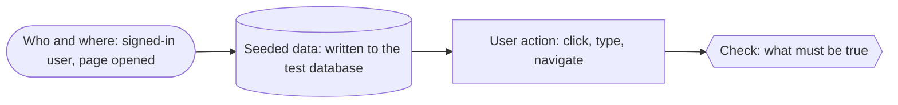

# E2E test flows

One flowchart per Playwright test: what state it starts from, what the user does, and what it checks. Coverage by feature is in [../e2e-test-coverage.md](../e2e-test-coverage.md); the tests themselves are in [`tests/e2e/`](../../tests/e2e).

Tests that run the same flow with different values (the 17 protected routes, the three legal pages, the four not-found sections, mobile and tablet) share one diagram, with the values listed in it.

## Legend

Headings match the test titles, so a failing test in the report leads straight to its diagram. When a test changes, its diagram changes in the same commit.

## By area

| Area | Specs | Flows |
|---|---|---|
| [Auth and session](auth.md) | `auth/auth-form`, `auth/session` | Sign-up, sign-in, sign-out, expiry, brute force, protected routes |
| [Public pages and errors](public.md) | `home`, `navigation/*`, `errors` | Landing, legal pages, settings and language, 404s |
| [Routines](routines.md) | `routines/*` | Create, editor, set variants, days, options, lists |
| [Training](training.md) | `training/*` | Today's training, routine progress, history |
| [Workouts](workouts.md) | `workouts/*` | Create, train, lock, options, list |
| [Sharing](sharing.md) | `sharing/*` | Members, sending, public and private, shared with me |
| [Profile and account](profile.md) | `profile/*` | Profile, following, account settings |
| [States and responsive](states.md) | `states`, `responsive` | Errors, offline, loading, server validation, layouts |
