# Auth and session flows

[← All flows](README.md)

## `auth/auth-form.spec.ts`

### auth form › switches between sign in and sign up

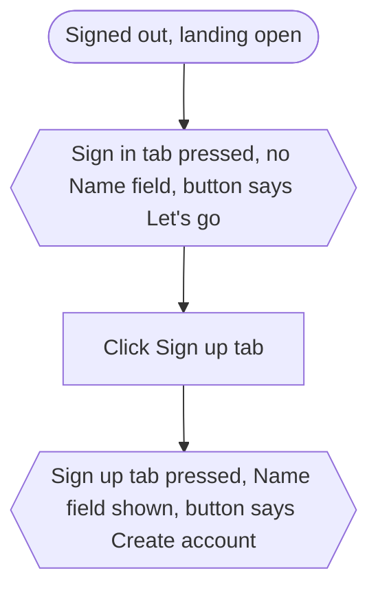

### auth form › blocks an empty submit

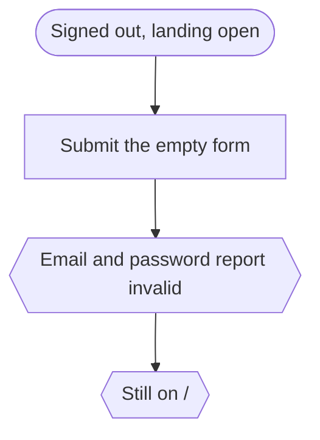

### auth form › validates email format and password length

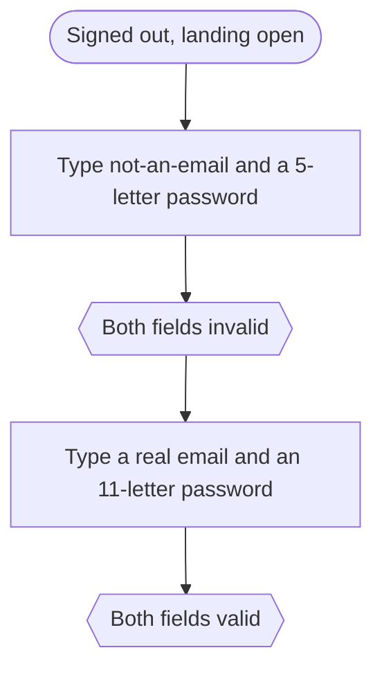

### auth form › sign up requires a name

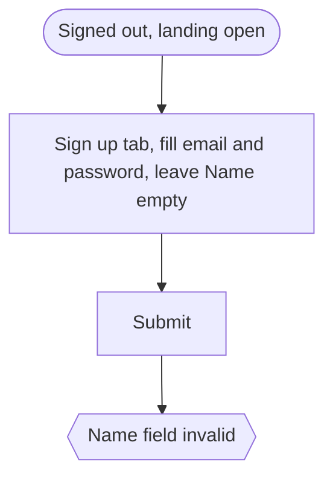

## `auth/session.spec.ts`

### sign up › creates the account and signs it in

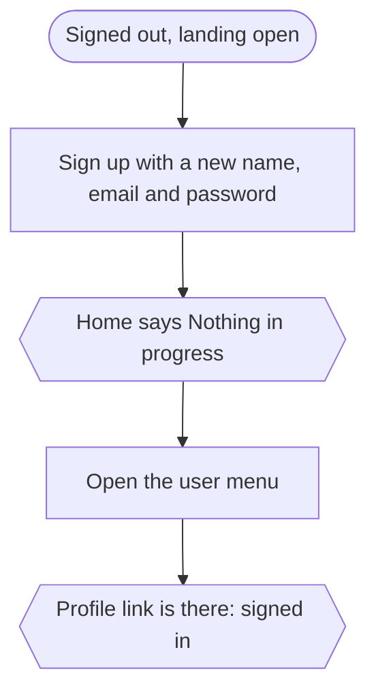

### sign up › refuses an email that already has an account

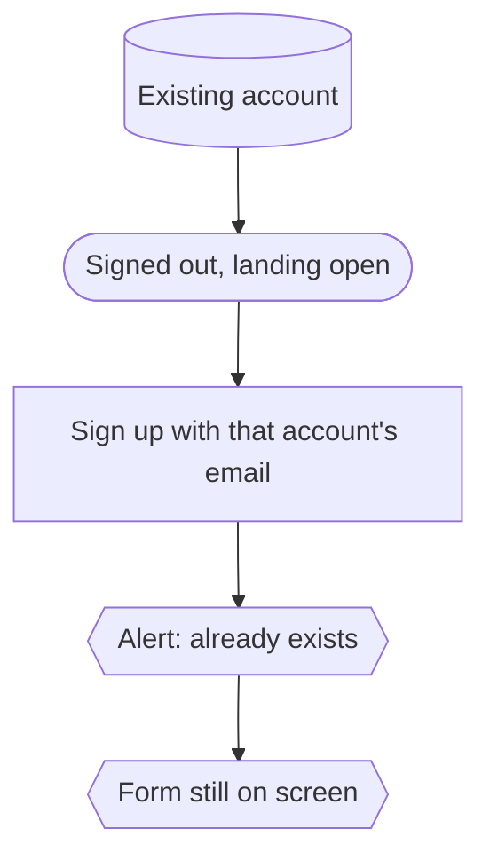

### sign in › with the right password

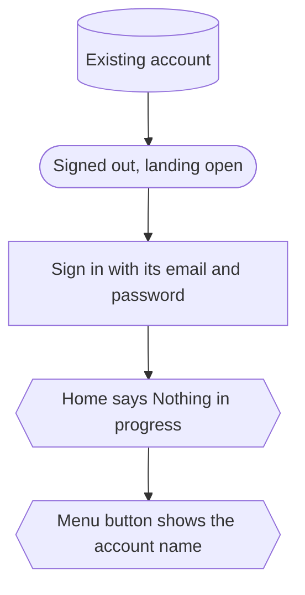

### sign in › with the wrong password shows the error and stays out

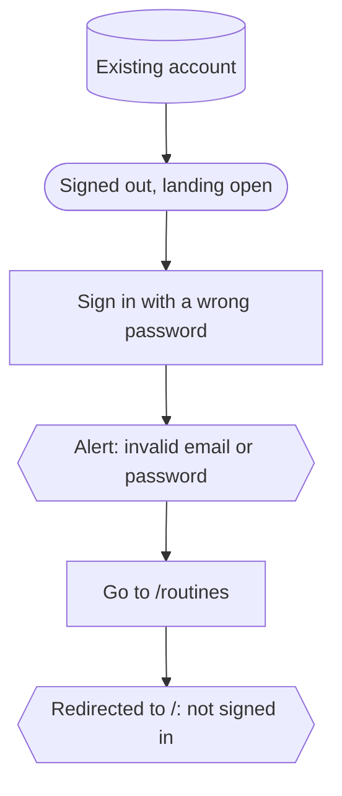

### sign in › a double click sends one request and locks the button

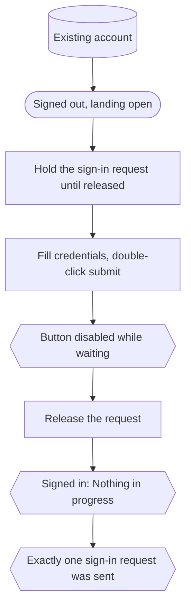

### brute-force protection › repeated failed sign-ins from one client are throttled

Production build only: `next dev` turns rate limiting off.

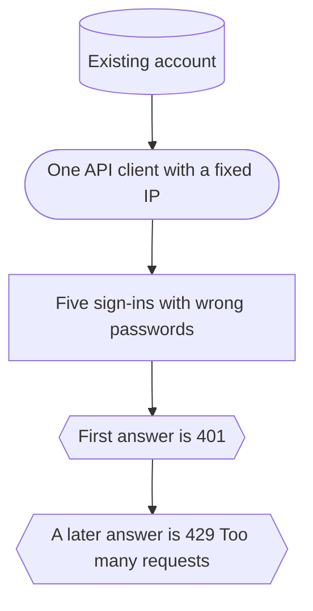

### session › sign out asks first, then ends the session

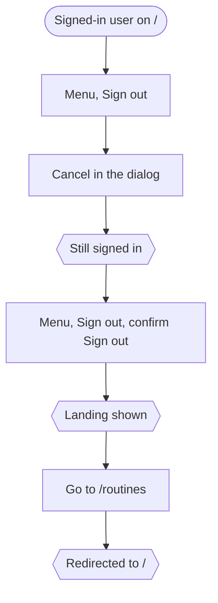

### session › an expired session is treated as signed out

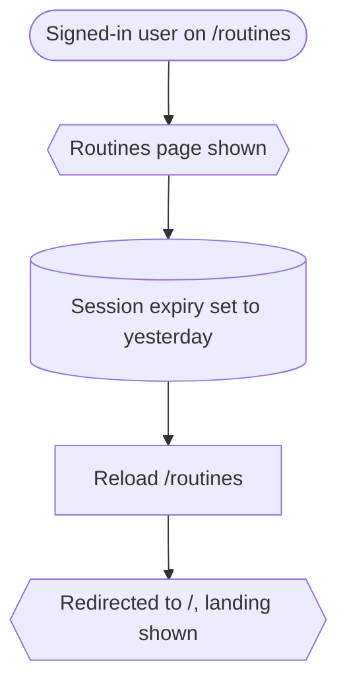

### route protection (signed out) › redirects home

One test per page: `/routines`, `/routines/all`, `/routines/requests`, `/routines/shared`, `/routines/shared/all`, `/routines/some-id`, `/routines/some-id/people`, `/routines/shared/some-id`, `/workouts`, `/workouts/all`, `/workouts/requests`, `/workouts/some-id`, `/profile/some-id`, `/profile/some-id/follows`, `/progress/some-id`.

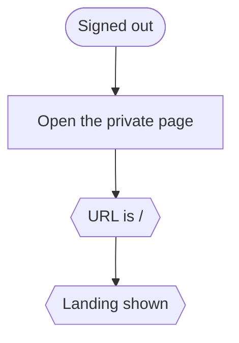

### route protection (signed out) › export answers 401

One test per route: `/routines/x/export`, `/progress/x/export`.

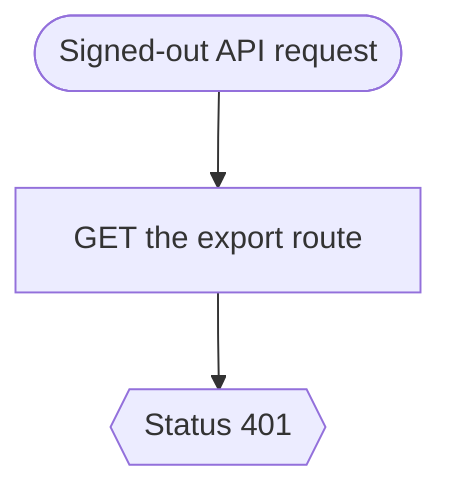
