# Profile and account flows

[← All flows](README.md)

## `profile/profile.spec.ts`

### profiles and follows › my profile: reached from the menu, empty to begin with

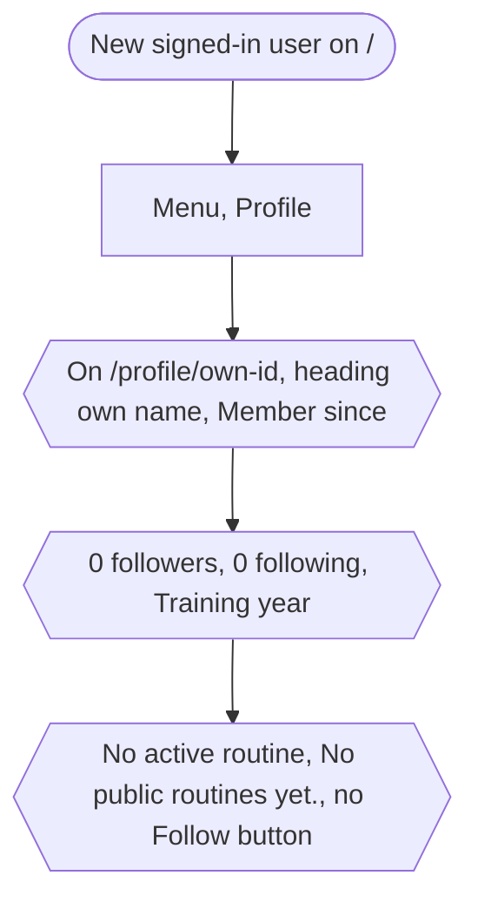

### profiles and follows › a profile shows the active routine and the finished public ones

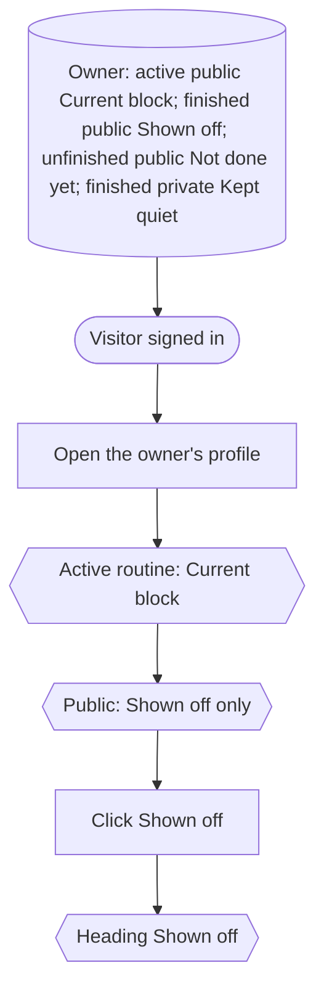

### profiles and follows › follow and unfollow, with the counts and lists to match

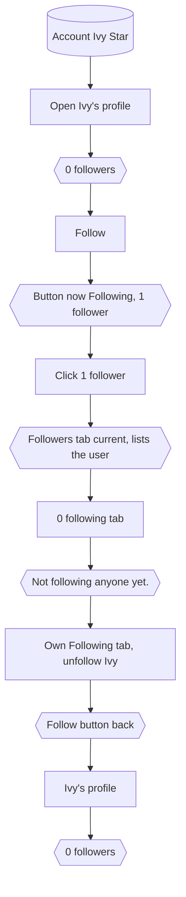

### profiles and follows › followers can be followed back from the list

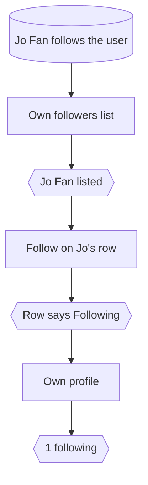

### profiles and follows › an empty followers tab says so

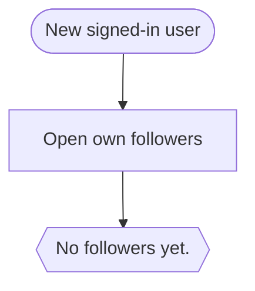

### profiles: long lists and sharing › followers load fifty at a time

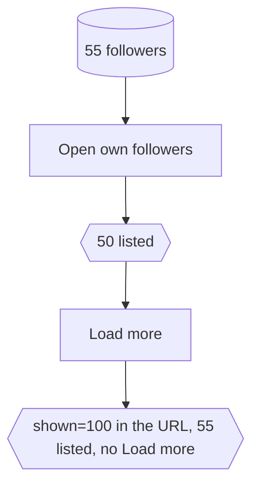

### profiles: long lists and sharing › share copies the profile link

Chromium only (clipboard permissions).

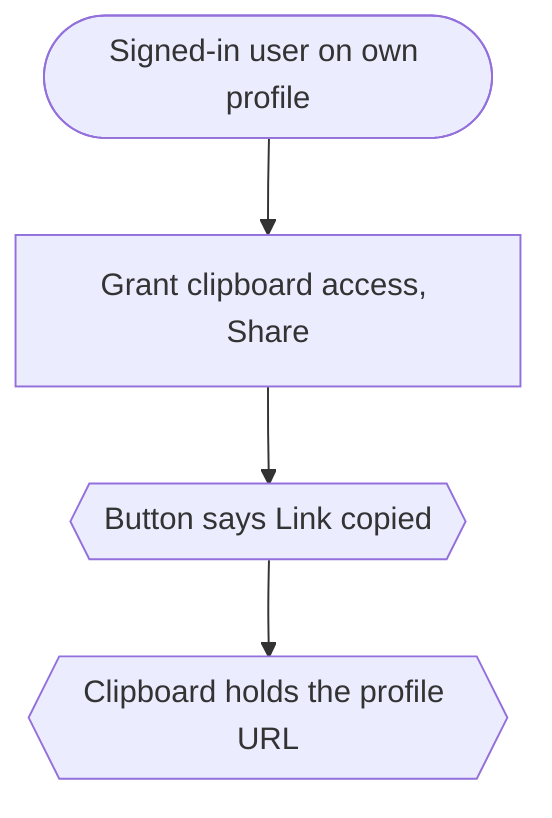

## `profile/account.spec.ts`

Every test opens Settings from the user menu first.

### account settings (signed in) › change the username

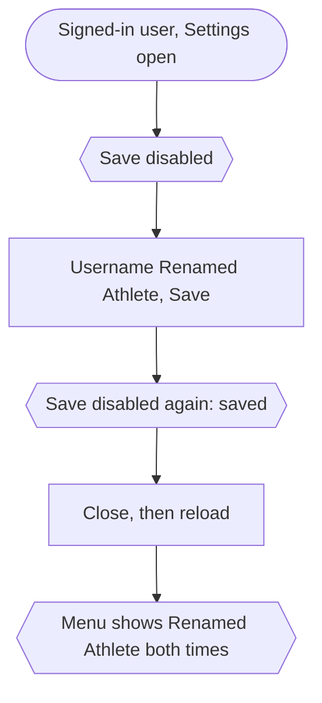

### account settings (signed in) › upload and remove a profile picture

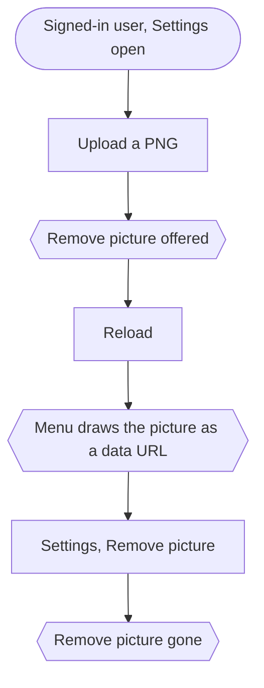

### account settings (signed in) › a file that is not an image is refused with a message

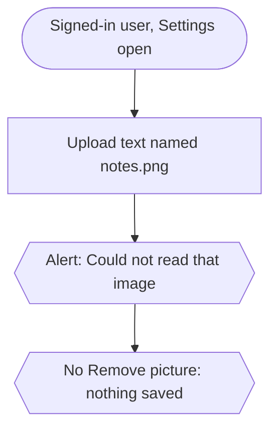

### account settings (signed in) › delete the account: asks, then it is gone for good

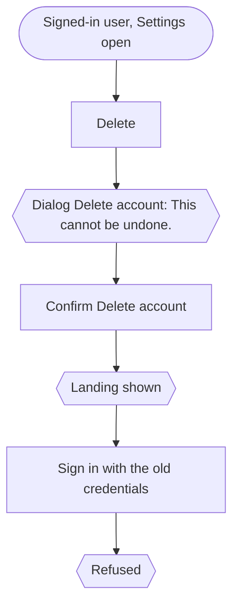

### account settings (signed in) › the language chosen here applies to the app pages

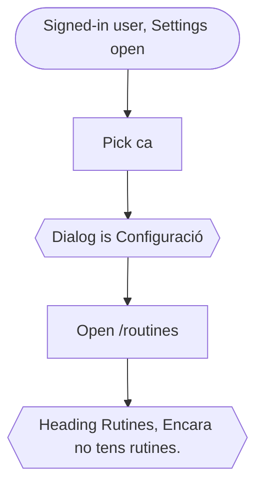
