# Public pages and error flows

[← All flows](README.md)

## `home.spec.ts`

### home page (signed out) › loads with title and hero

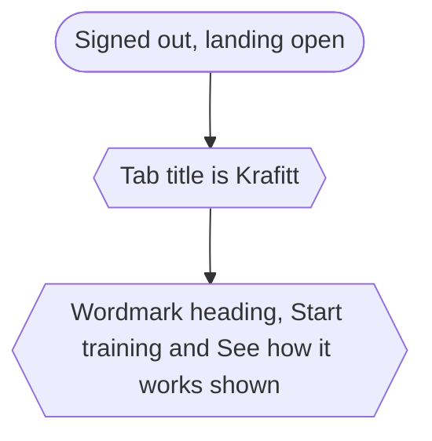

### home page (signed out) › shows every landing section

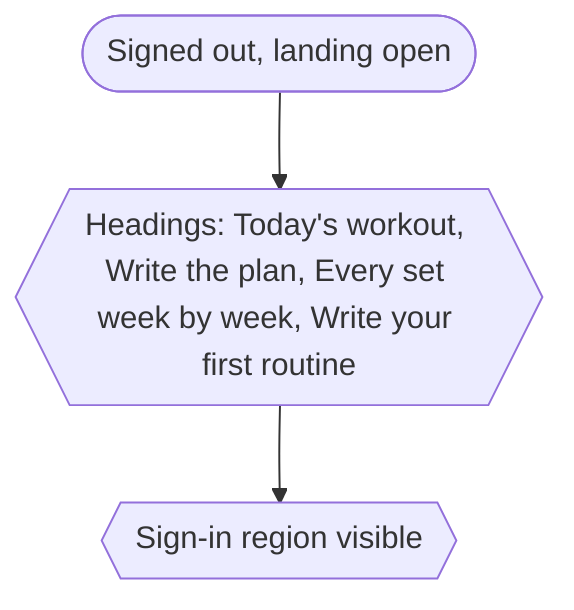

### home page (signed out) › renders header and footer chrome

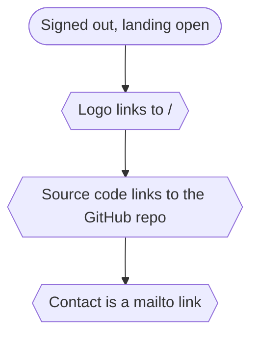

## `navigation/navigation.spec.ts`

### navigation › hero CTAs jump to their sections

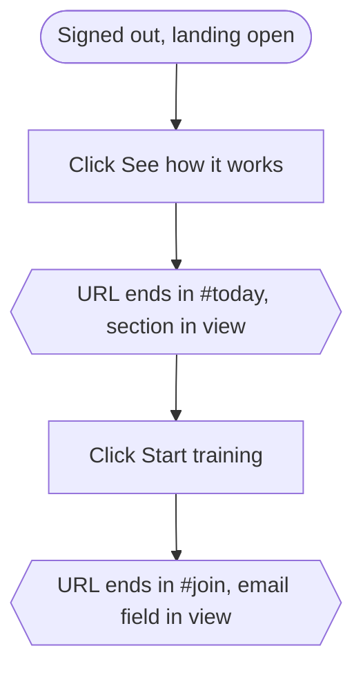

### navigation › footer opens the legal page

One test per page: Privacy policy → `/legal/privacy`, Terms of service → `/legal/terms`, Cookie policy → `/legal/cookies`.

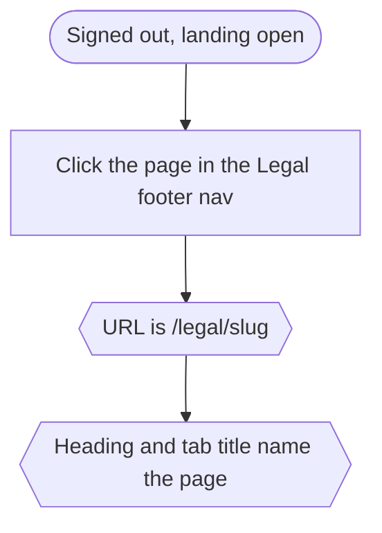

### navigation › back button returns to the previous page

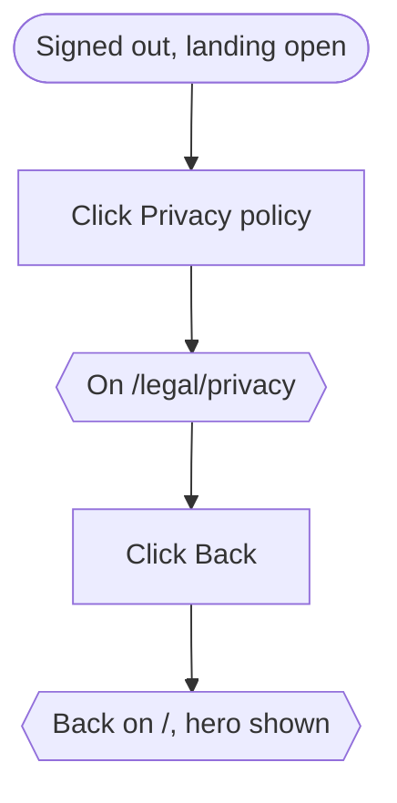

### navigation › logo leads home from a deep link

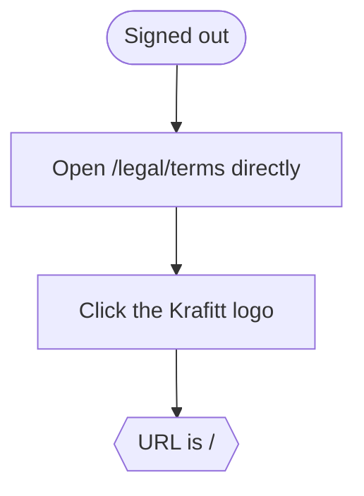

## `navigation/settings.spec.ts`

### settings modal (signed out) › opens and closes

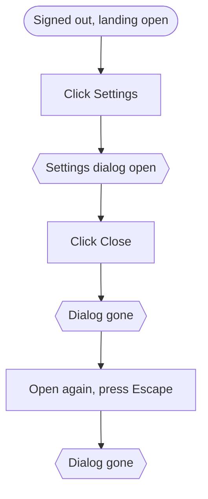

### settings modal (signed out) › theme switch toggles dark mode

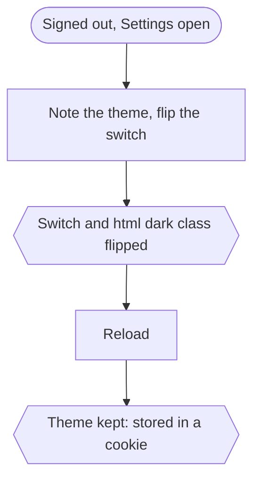

### settings modal (signed out) › language switch translates the page

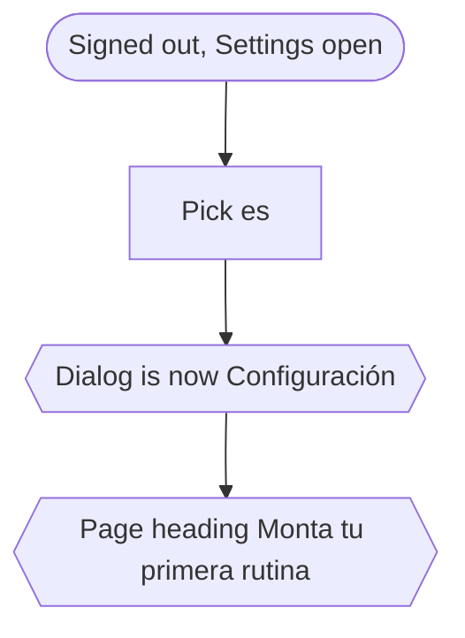

### settings modal (signed out) › Catalan translates the page and survives a reload

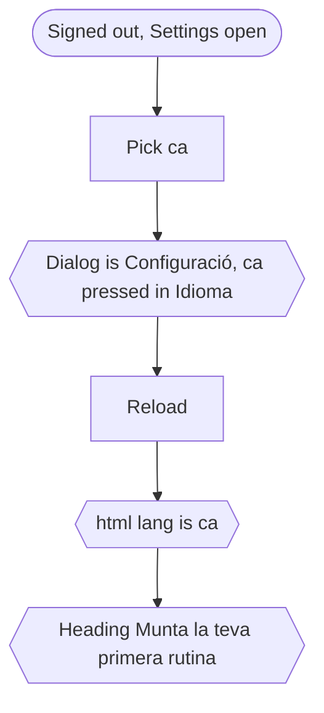

## `errors.spec.ts`

### not found › unknown route answers 404

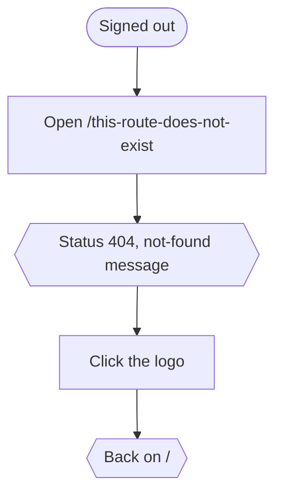

### not found › unknown legal document shows the not-found page

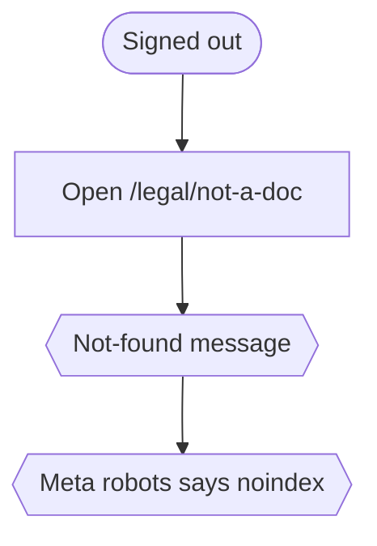

The status is 200, not 404: the page has a `loading.tsx`, so the response is already streaming when `notFound()` runs.

### not found › signed in, an unknown /section/[id] is not found

One test per section: `routines`, `workouts`, `profile`, `progress`.

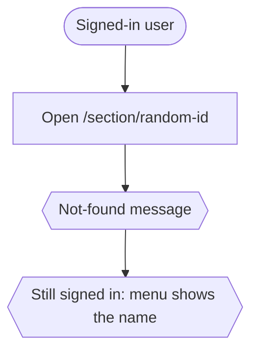

### not found › a workout is not found under /routines, nor a routine under /workouts

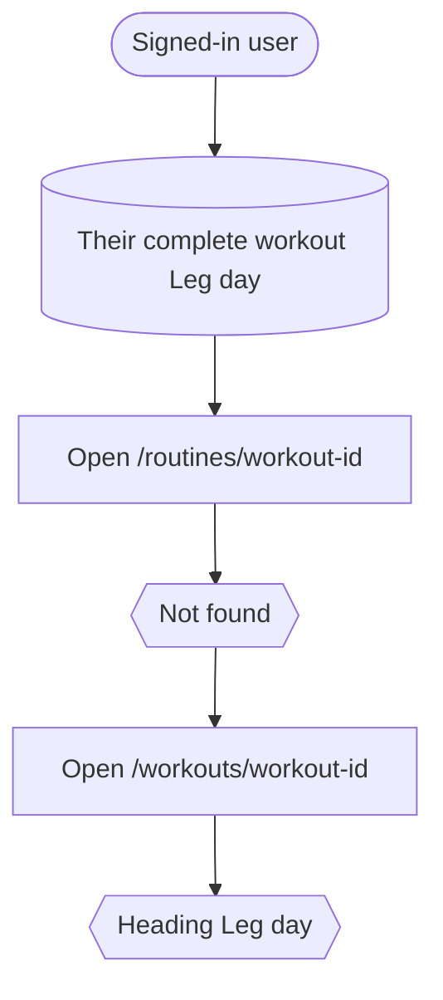
