# Routine flows

[← All flows](README.md)

A seeded **complete routine** has the days Push and Pull, each with a press (sets 1 and 2, rep ranges) and a row (one fixed set): three sets a day, four weeks long unless the diagram says otherwise.

## `routines/create.spec.ts`

Every test starts signed in on `/routines`, with the New routine form hydrated and empty.

### create a routine › starts empty, with nothing to show

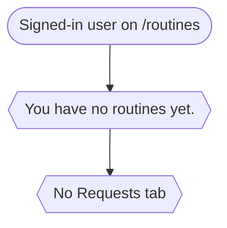

### create a routine › the button waits for a name and a valid duration

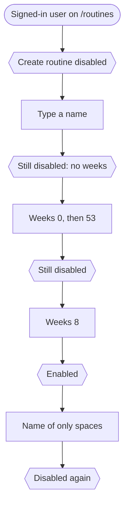

### create a routine › a fixed-length routine opens on its own page and is listed

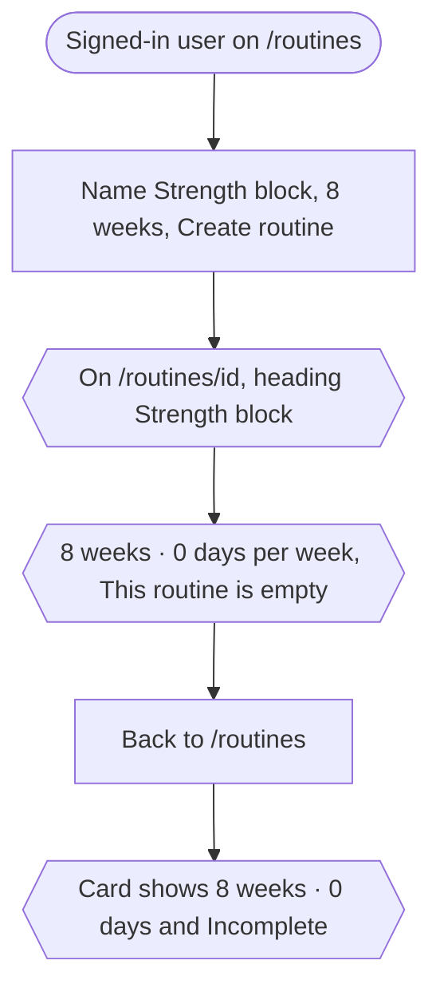

### create a routine › an open-ended routine takes no duration

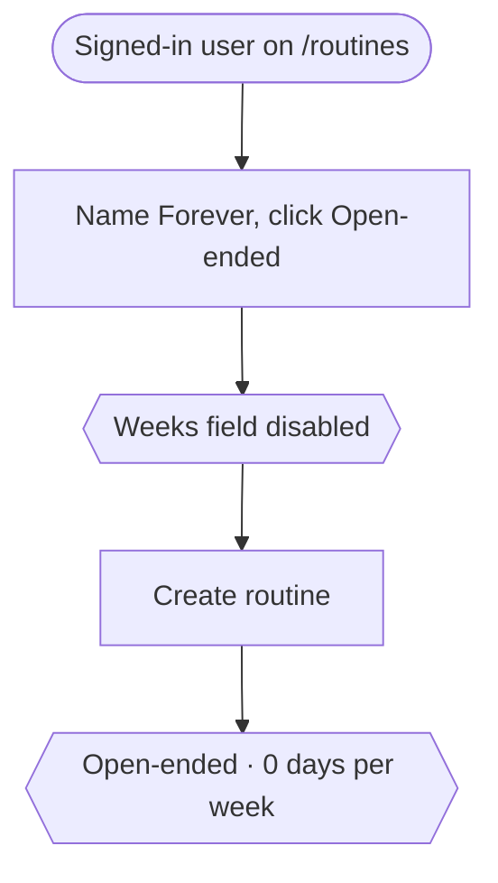

## `routines/editor.spec.ts`

### routine editor › build a routine from scratch, save it and set it active

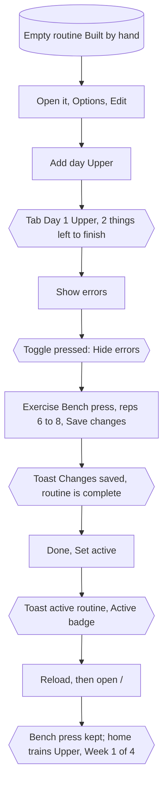

### routine editor › a routine with holes cannot be set active

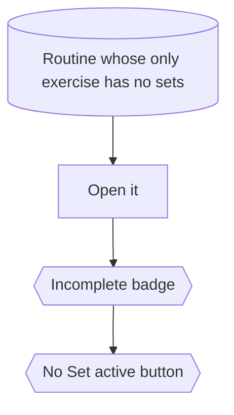

### routine editor › undo puts the day back as it was saved

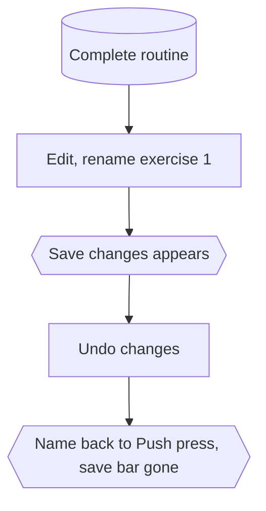

### routine editor › leaving edit mode with unsaved changes asks before discarding

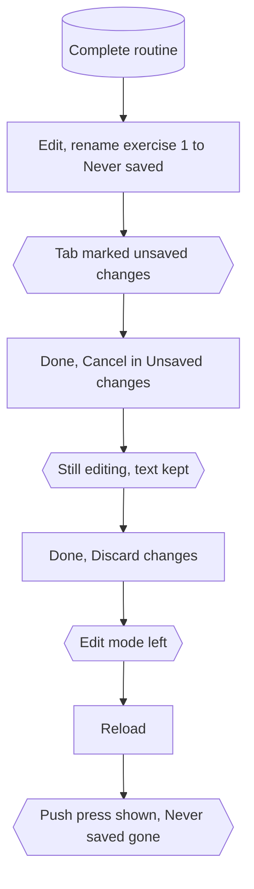

### routine editor › exercises: add, remove, reorder and add sets, then persist

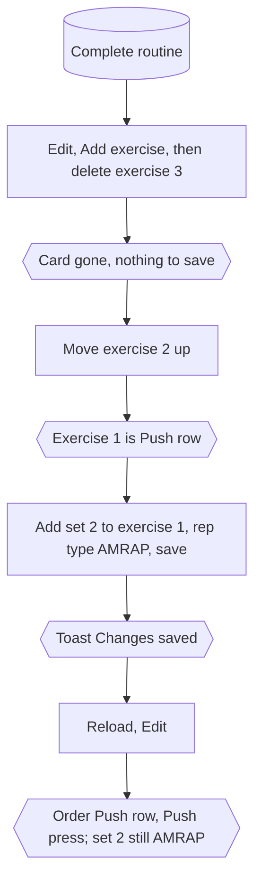

### routine editor › days: rename, reorder and delete before the routine starts

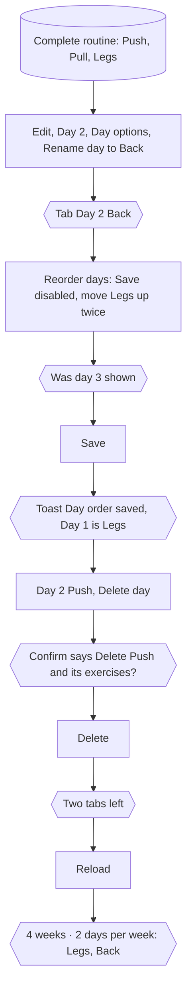

### routine editor › once started, days can no longer be added, moved or deleted

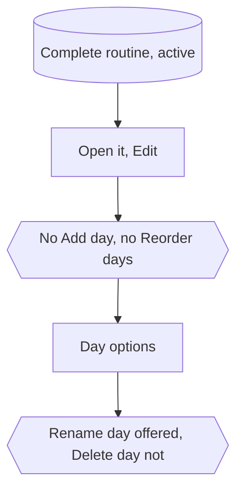

### routine editor › day tabs switch with buttons and arrow keys

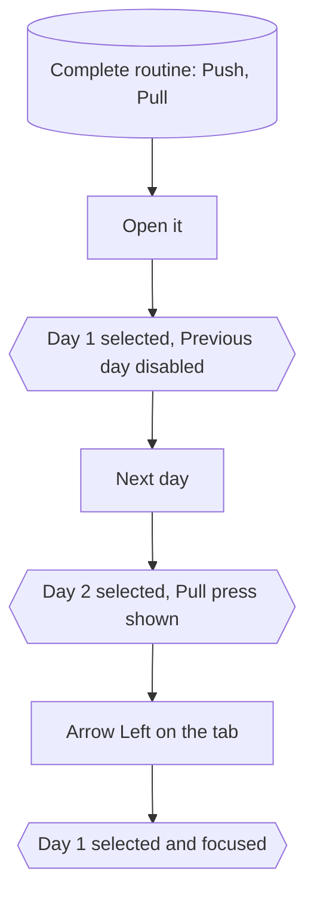

## `routines/editor-variants.spec.ts`

### editor: what a set can be › techniques: a preset, a custom name, and removing it

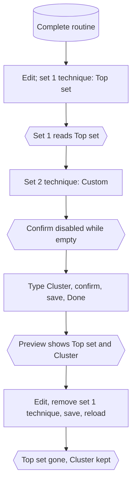

### editor: what a set can be › drop sets and rest-pause sets hang off a working set

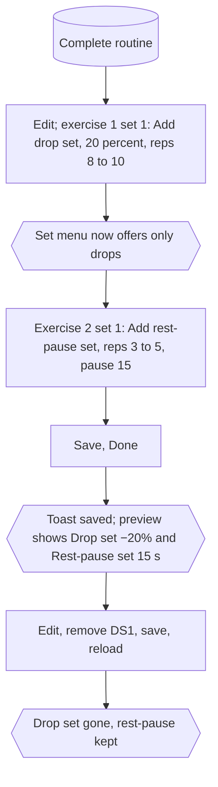

### editor: what a set can be › a rest-pause set without its pause is a hole in the plan

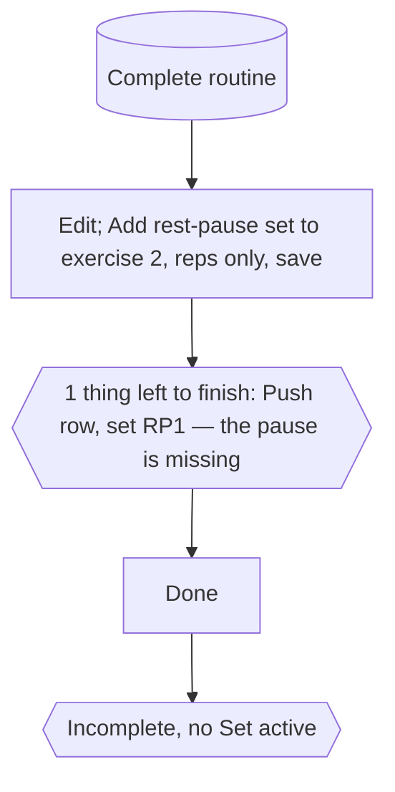

### editor: what a set can be › a timed set is written and trained in seconds

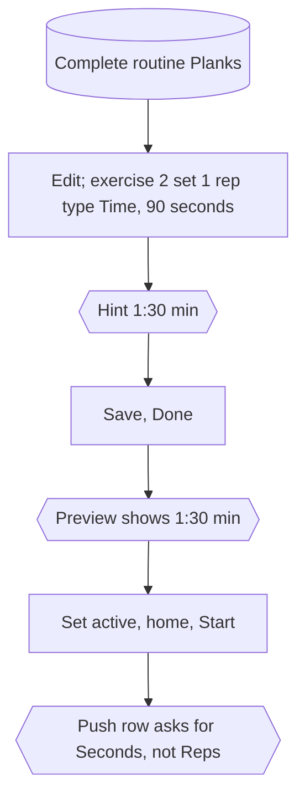

### editor: what a set can be › a preview-only exercise is shown but never logged

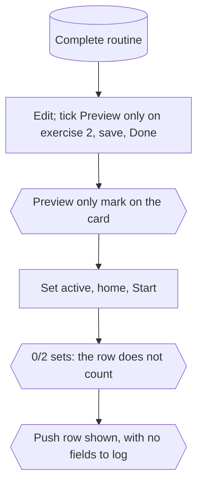

### editor: what a set can be › a day of nothing but previews cannot be trained

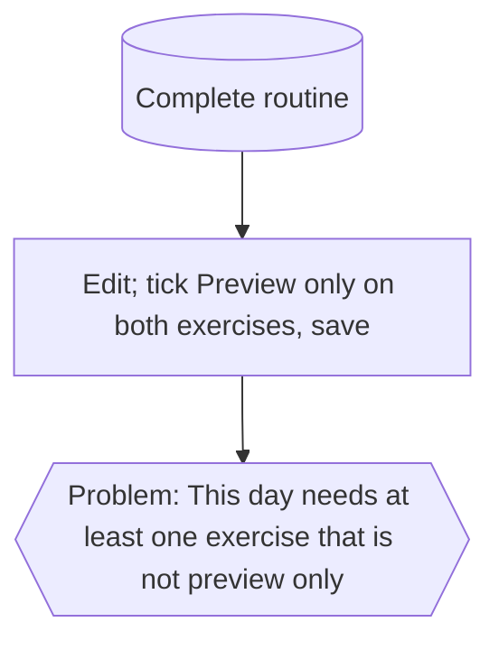

### editor: what a set can be › a removed exercise with history is offered back, history and all

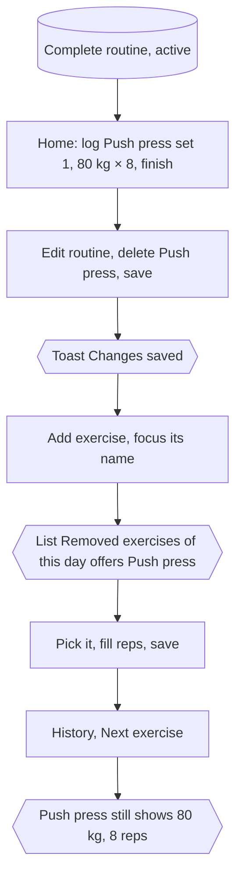

## `routines/options.spec.ts`

### routine options › rename: the save waits for a change, and the name persists

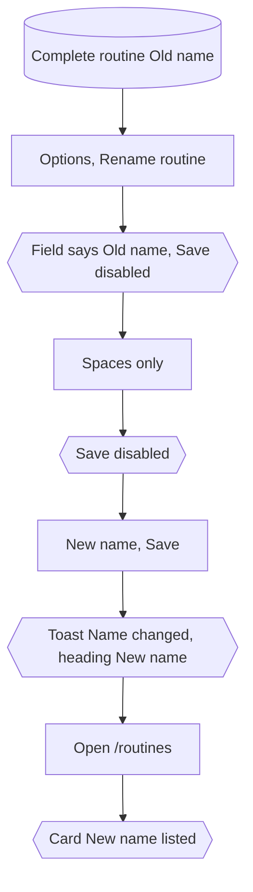

### routine options › duration: refuses weeks out of range and saves a valid one

```mermaid
flowchart TD
    D[("Complete routine, 4 weeks")]
    A1["Options, Change duration"]
    C1{{"Field says 4"}}
    A2["0, 53 and 4"]
    C2{{"Save disabled for each"}}
    A3["12, Save"]
    C3{{"Toast Duration changed, 12 weeks · 2 days per week"}}
    A4["Reload"]
    C4{{"Still 12 weeks"}}
    D --> A1 --> C1 --> A2 --> C2 --> A3 --> C3 --> A4 --> C4
```

### routine options › an open-ended routine has no duration to change

```mermaid
flowchart TD
    D[("Complete open-ended routine")]
    A1["Open Options"]
    C1{{"Rename routine offered, Change duration not"}}
    D --> A1 --> C1
```

### routine options › visibility: public shows the share button, private hides it

```mermaid
flowchart TD
    D[("Complete private routine")]
    C1{{"No Share button"}}
    A1["Options, Make public"]
    C2{{"Toast now public, Share button shown"}}
    A2["Options, Make private"]
    C3{{"Toast now private, Share button gone"}}
    D --> C1 --> A1 --> C2 --> A2 --> C3
```

### routine options › share copies the routine link

Chromium only (clipboard permissions).

```mermaid
flowchart TD
    D[("Complete public routine")]
    A1["Grant clipboard access, click Share"]
    C1{{"Button says Link copied"}}
    C2{{"Clipboard holds the page URL"}}
    D --> A1 --> C1 --> C2
```

### routine options › duplicate asks, then opens a fresh private copy

```mermaid
flowchart TD
    D[("Complete routine Original, active")]
    A1["Options, Duplicate routine"]
    C1{{"Dialog: the copy starts from scratch"}}
    A2["Confirm"]
    C2{{"Toast Copy of Original created, new URL"}}
    C3{{"Heading Original copy, Set active shown, two days"}}
    D --> A1 --> C1 --> A2 --> C2 --> C3
```

### routine options › delete asks, can be cancelled, and removes the routine

```mermaid
flowchart TD
    D[("Complete routine Doomed")]
    A1["Options, Delete routine, Cancel"]
    C1{{"Still on Doomed"}}
    A2["Options, Delete routine, Delete"]
    C2{{"On /routines: You have no routines yet."}}
    A3["Open the old URL"]
    C3{{"Not found"}}
    D --> A1 --> C1 --> A2 --> C2 --> A3 --> C3
```

### routine options › set active and deactivate

```mermaid
flowchart TD
    D[("Complete routine Toggle")]
    A1["Set active"]
    C1{{"Toast now your active routine"}}
    A2["Deactivate"]
    C2{{"Toast no longer active, Set active back"}}
    A3["Open /"]
    C3{{"Nothing in progress"}}
    D --> A1 --> C1 --> A2 --> C2 --> A3 --> C3
```

### routine options › only one routine is active at a time

```mermaid
flowchart TD
    D[("First active, Second not")]
    A1["Second: Set active"]
    C1{{"Toast Second is now your active routine"}}
    A2["Open First"]
    C2{{"First offers Set active again"}}
    D --> A1 --> C1 --> A2 --> C2
```

### routine options › export downloads the plan as an .xlsx

```mermaid
flowchart TD
    D[("Complete routine Spreadsheet")]
    A1["Options, Export to Excel"]
    C1{{"Download from /routines/id/export"}}
    A2["GET the same route"]
    C2{{"Spreadsheet content type, filename Spreadsheet.xlsx, zip bytes PK"}}
    D --> A1 --> C1 --> A2 --> C2
```

### routine options › an incomplete routine offers no export or send, and the route refuses it

```mermaid
flowchart TD
    D[("Routine with an empty exercise")]
    A1["Open Options"]
    C1{{"No Export to Excel, no Send routine"}}
    A2["GET /routines/id/export"]
    C2{{"Status 409"}}
    D --> A1 --> C1 --> A2 --> C2
```

### routine options › a finished routine is read-only

```mermaid
flowchart TD
    D[("Complete routine, all 8 days walked")]
    A1["Open it"]
    C1{{"Finished badge"}}
    A2["Open Options"]
    C2{{"No Edit, Rename or Change duration; Duplicate offered"}}
    D --> A1 --> C1 --> A2 --> C2
```

## `routines/list.spec.ts`

### routine lists › the index previews five and links to the full list

```mermaid
flowchart TD
    D[("Six routines")]
    A1["Open /routines"]
    C1{{"Five cards"}}
    A2["View more"]
    C2{{"On /routines/all, My routines, six cards"}}
    D --> A1 --> C1 --> A2 --> C2
```

### routine lists › search narrows by name, and says so when nothing matches

```mermaid
flowchart TD
    D[("Leg day, Upper body")]
    A1["/routines/all, search leg"]
    C1{{"URL has q=leg, only Leg day"}}
    A2["Search zzz"]
    C2{{"Nothing matches your search."}}
    A3["Clear the search"]
    C3{{"Both listed"}}
    D --> A1 --> C1 --> A2 --> C2 --> A3 --> C3
```

### routine lists › the status filter counts and filters

```mermaid
flowchart TD
    D[("One active, one ready, one draft")]
    A1["Open /routines/all"]
    C1{{"All 3 checked, Active 1, Finished 0"}}
    A2["Pick Incomplete"]
    C2{{"status=incomplete, only the draft"}}
    A3["Pick Active"]
    C3{{"status=active, only the active one"}}
    D --> A1 --> C1 --> A2 --> C2 --> A3 --> C3
```

### routine lists › pagination walks ten at a time and keeps the search

```mermaid
flowchart TD
    D[("Twelve routines Block 1 to 12")]
    A1["Open /routines/all?q=Block"]
    C1{{"Page 1 of 2, ten cards"}}
    A2["Next"]
    C2{{"page=2 and q=Block in the URL, two cards, no Next"}}
    A3["Previous"]
    C3{{"Page 1 of 2"}}
    D --> A1 --> C1 --> A2 --> C2 --> A3 --> C3
```

### routine lists › a card opens its routine and shows its progress

```mermaid
flowchart TD
    D[("Complete routine Halfway, active, 3 days walked")]
    A1["Open /routines"]
    C1{{"Card shows 3/8 days and Active"}}
    A2["Click the card"]
    C2{{"On /routines/id"}}
    D --> A1 --> C1 --> A2 --> C2
```

### routine lists › tabs move between my routines and the ones shared with me

```mermaid
flowchart TD
    U(["Signed-in user on /routines"])
    A1["Click Shared with me"]
    C1{{"On /routines/shared: Nothing shared yet"}}
    U --> A1 --> C1
```
