# Sharing flows

[← All flows](README.md)

Where two people take part, each one is a box of their own: they are separate browser sessions, signed in as separate accounts.

## `sharing/members.spec.ts`

### routine members › invite by email, accept, then read the plan and its history

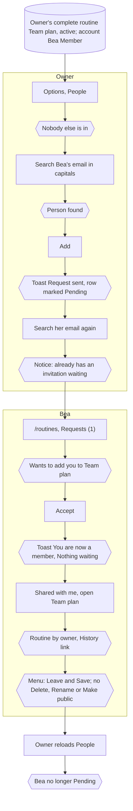

### routine members › search errors: unknown email, and your own

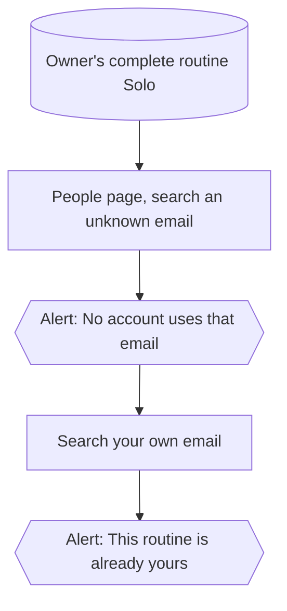

### routine members › the owner takes a member out, who then loses access

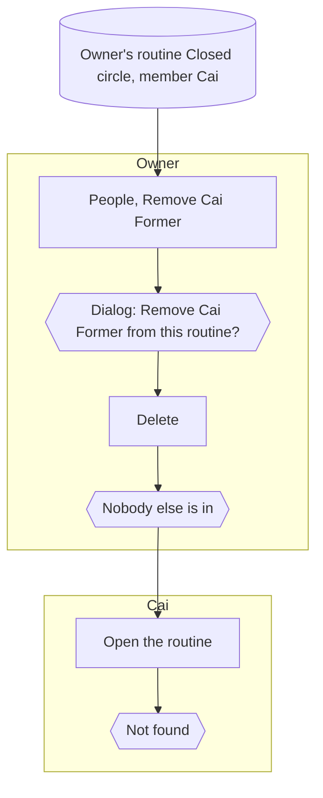

### routine members › a member can leave on their own

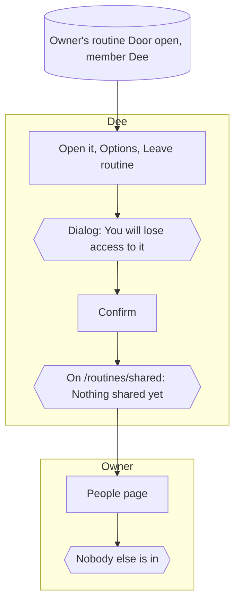

### routine members › an invitation can be declined, or taken back by the owner

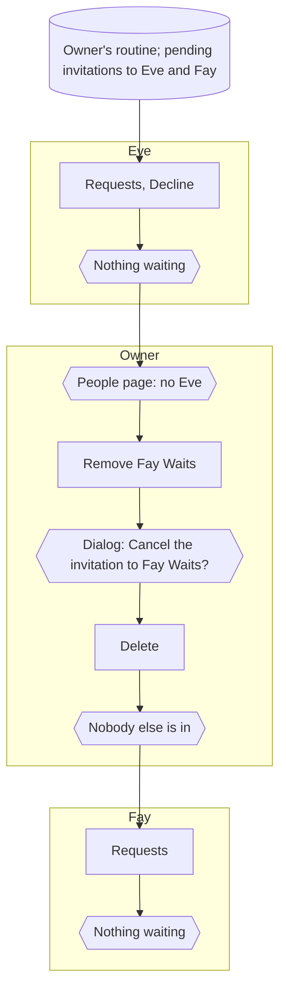

### routine members › the people page is the owner's alone

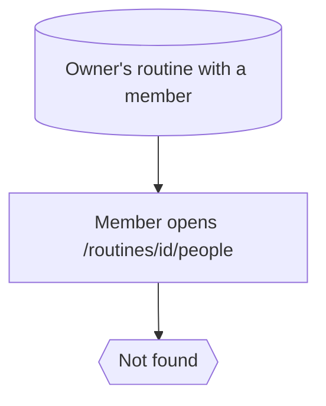

## `sharing/send.spec.ts`

### sending a routine › send with membership, accept, and both sides see it

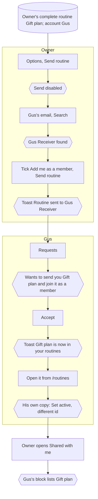

### sending a routine › unknown email and sending to yourself are refused

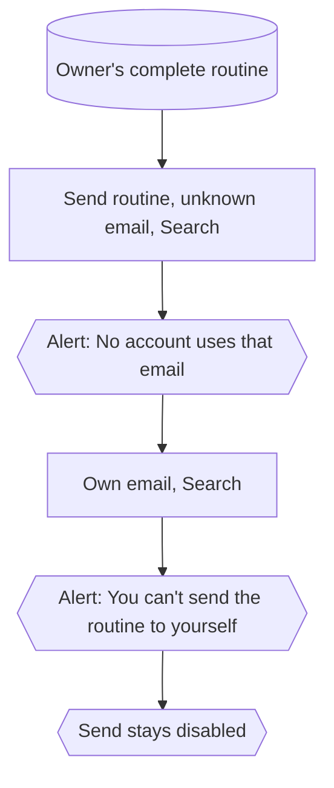

### sending a routine › a declined routine never arrives

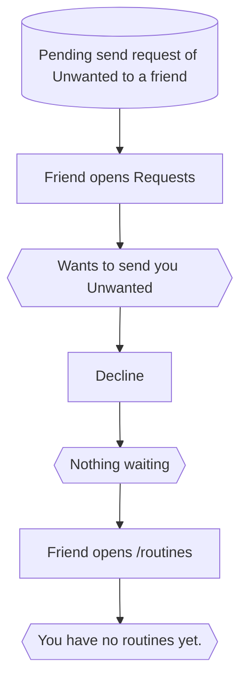

### sending a routine › a workout is sent to the workouts inbox

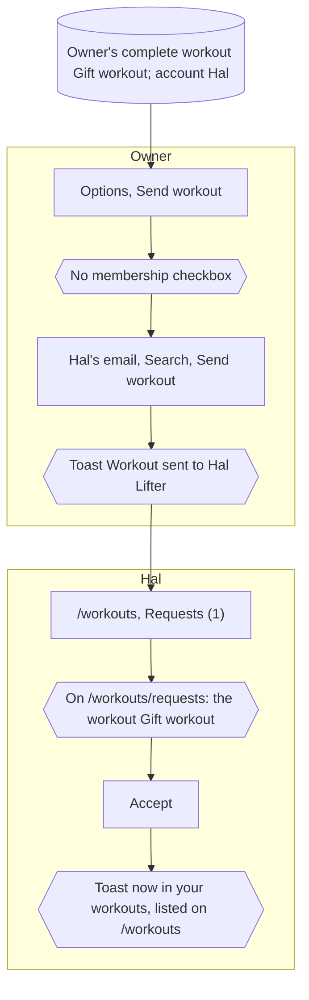

## `sharing/public.spec.ts`

### public and private plans › a private routine does not exist for anyone else

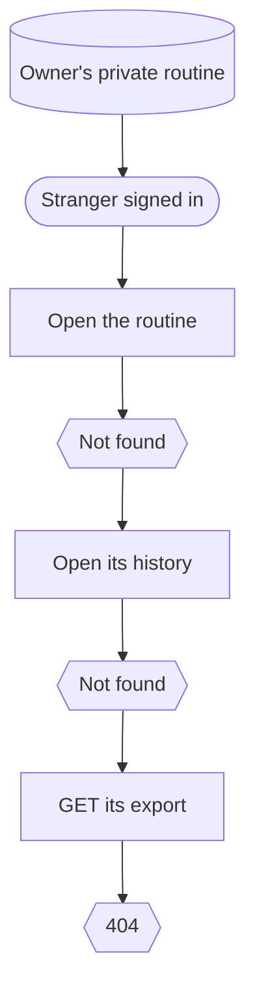

### public and private plans › a public routine can be read, exported and saved as a copy

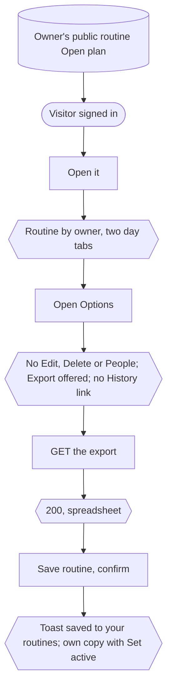

### public and private plans › the creator link leads to their profile

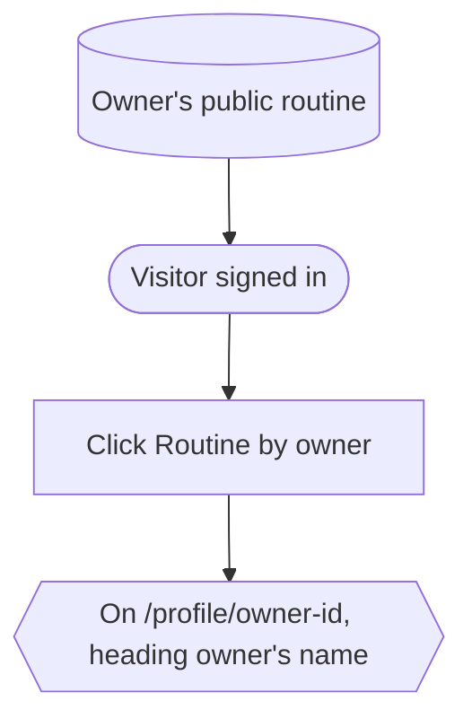

### public and private plans › a public workout can be saved; a private one is hidden

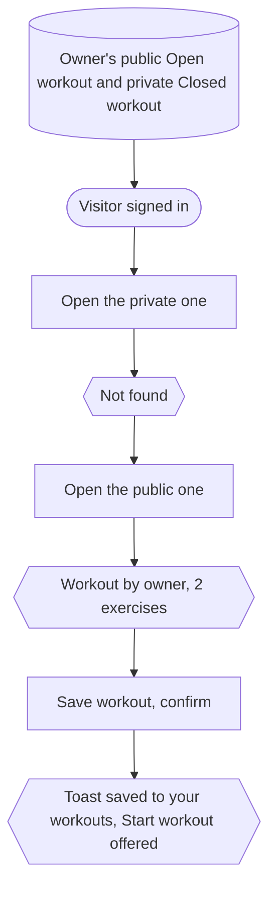

## `sharing/shared-list.spec.ts`

### shared with me › grouped by owner, three each, with a page of their own for the rest

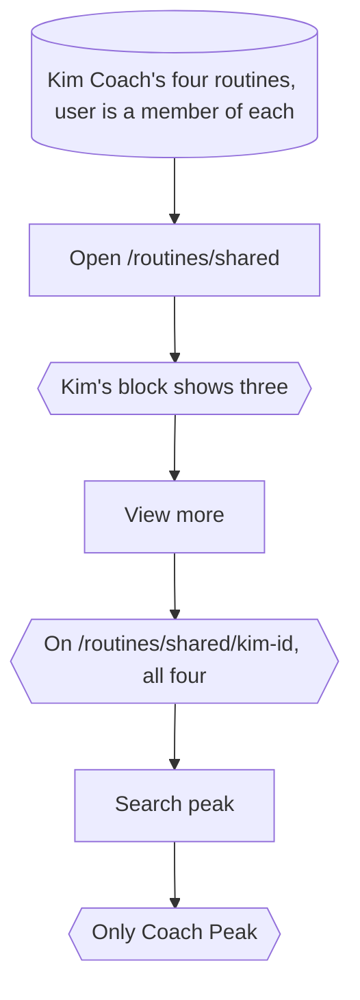

### shared with me › the full list searches by person or email

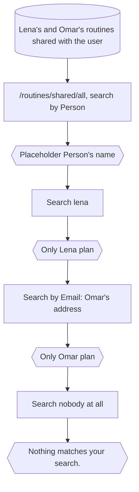

### shared with me › an owner who shares nothing with me has no page

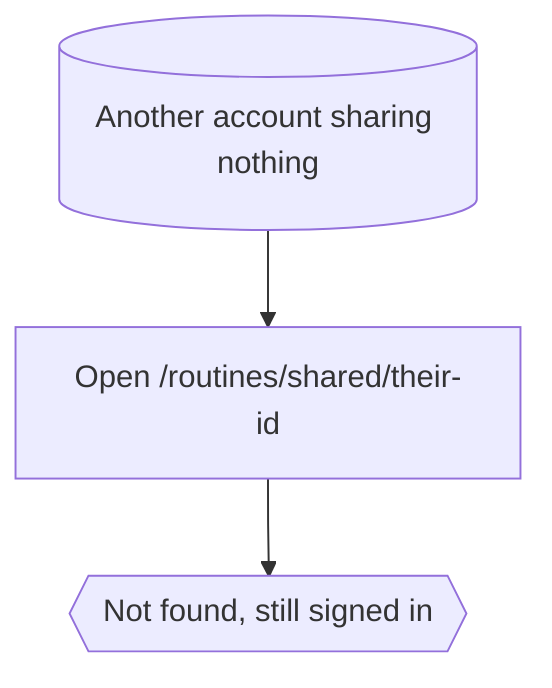
