# State and responsive flows

[← All flows](README.md)

## `states.spec.ts`

### application states › a failed server action says so and changes nothing

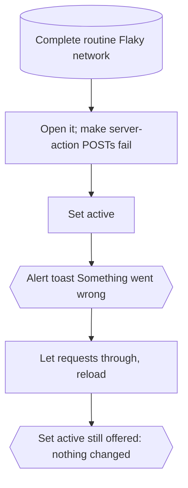

### application states › offline, an action fails visibly and works again once back online

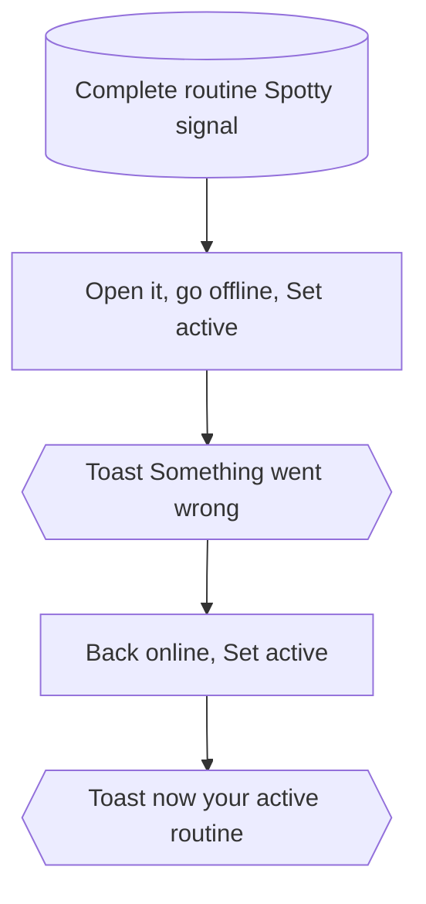

### application states › a page still loading shows its skeleton

Production build only: the skeleton arrives with the link's prefetch, which `next dev` does not make.

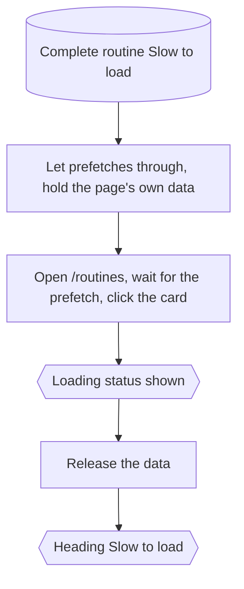

### application states › the server refuses what the form would never send

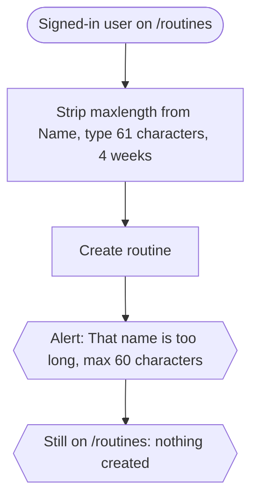

### application states › a finished routine leaves the home screen saying so

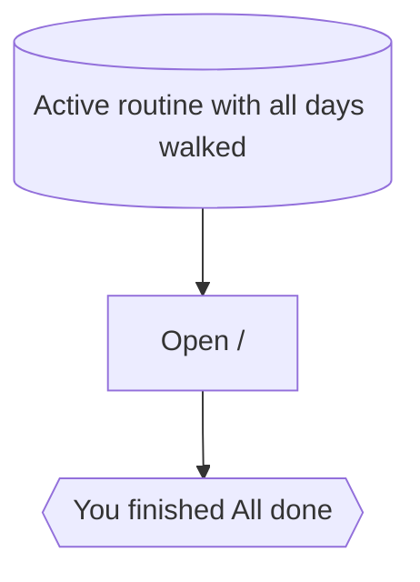

## `responsive.spec.ts`

### mobile and tablet viewport › fits the screen without horizontal scroll

One test per viewport: 375 × 812 and 768 × 1024.

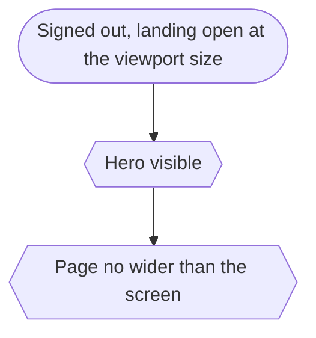

### mobile and tablet viewport › keeps the main actions reachable

One test per viewport: 375 × 812 and 768 × 1024.

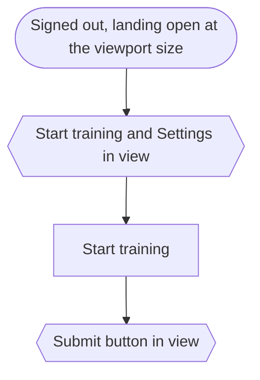

### signed in: desktop › the header carries the section links

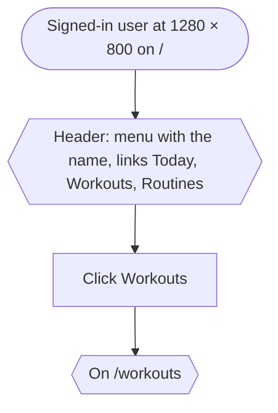

### signed in: mobile and tablet › the menu takes over navigation, and app pages fit the screen

One test per viewport: 375 × 812 and 768 × 1024.

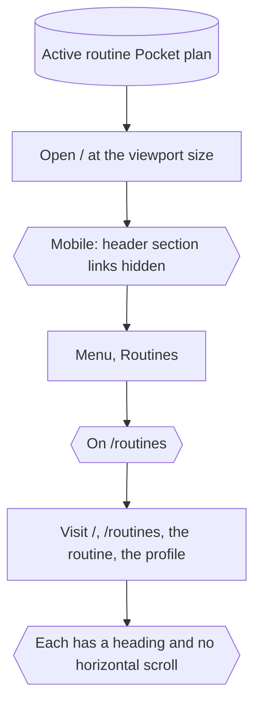

### signed in: mobile and tablet › training controls stay within reach

One test per viewport: 375 × 812 and 768 × 1024.

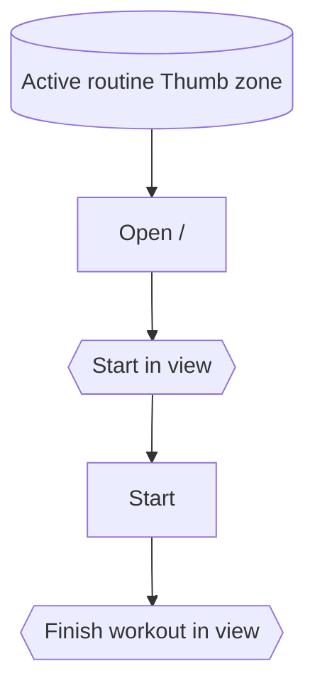

### signed in: mobile and tablet › the editor save bar follows the screen

One test per viewport: 375 × 812 and 768 × 1024.

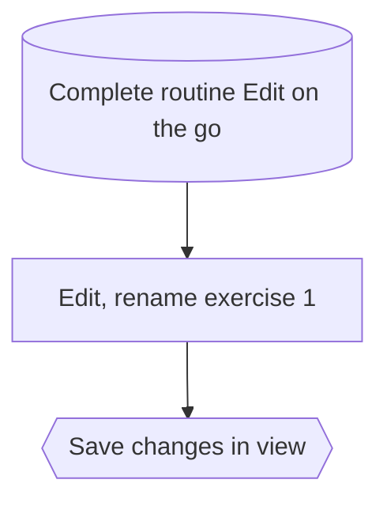
