# Training flows

[← All flows](README.md)

A seeded **complete routine** has the days Push and Pull, each with a press (sets 1 and 2, rep ranges) and a row (one fixed set): three sets a day, four weeks long unless the diagram says otherwise.

## `training/today.spec.ts`

### training today › idle: nothing active, nothing owed

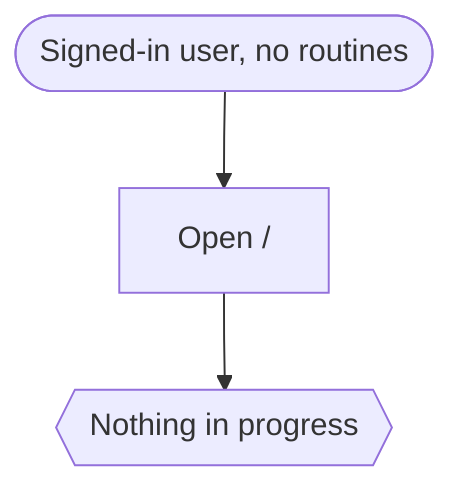

### training today › the active routine puts its day on the home screen

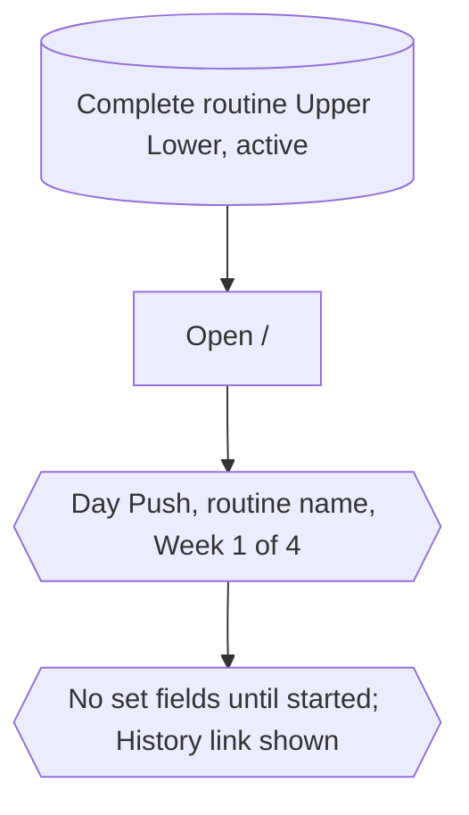

### training today › log sets in order, with their effort, and keep them across a reload

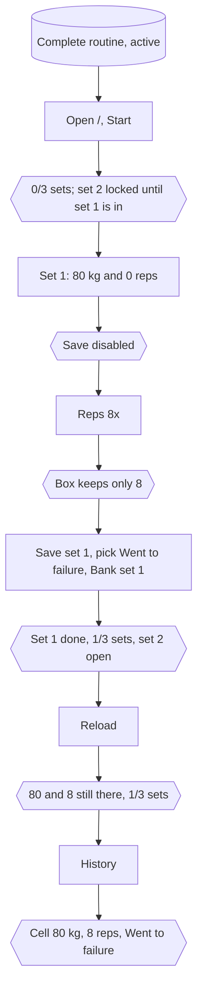

### training today › a weight of zero reads as bodyweight

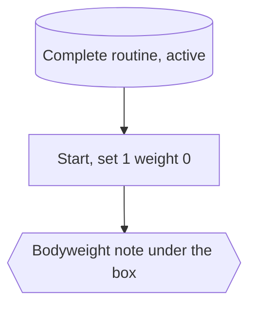

### training today › finishing with blanks asks, then moves on to the next day

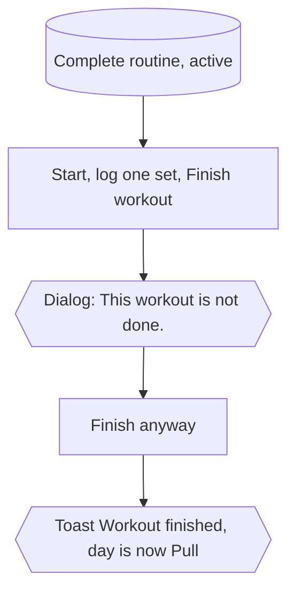

### training today › finishing with nothing logged calls the day off

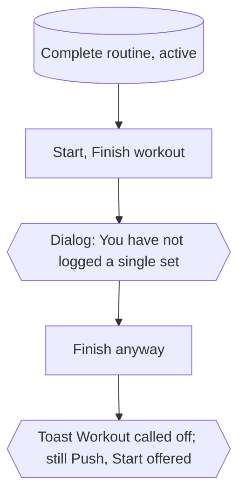

### training today › logging every set completes the day

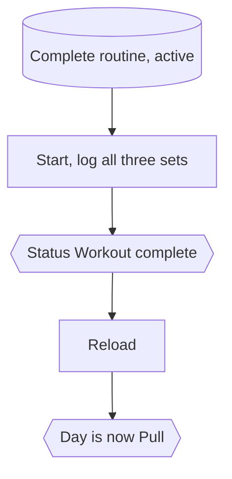

### training today › change day trains another day of the week first

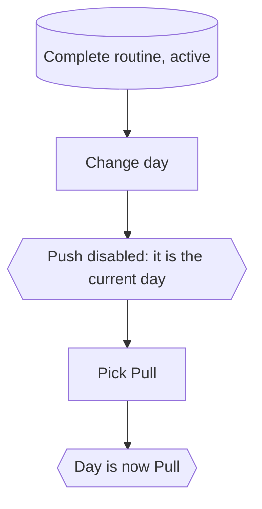

### training today › skip week asks, then jumps to next week

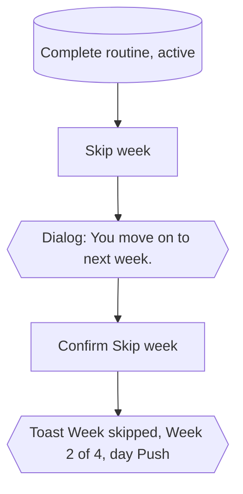

### training today › the next week shows what was lifted the week before

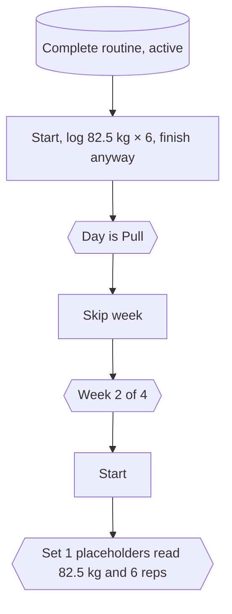

### training today › the last week can finish the whole routine

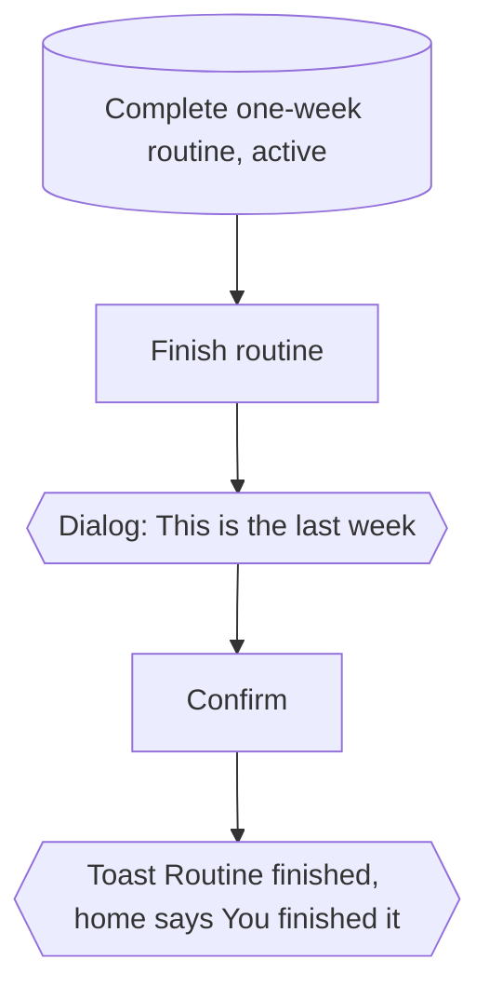

### training today › a day left incomplete is taken up again with what it had locked

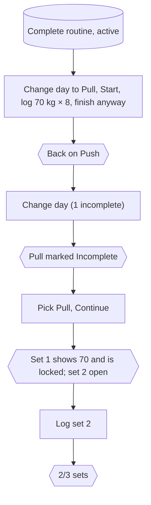

## `training/history.spec.ts`

Most tests first train Push on the home screen: 80 kg × 8 and 70 kg × 10, then finish anyway.

### history › the summary adds up what was lifted

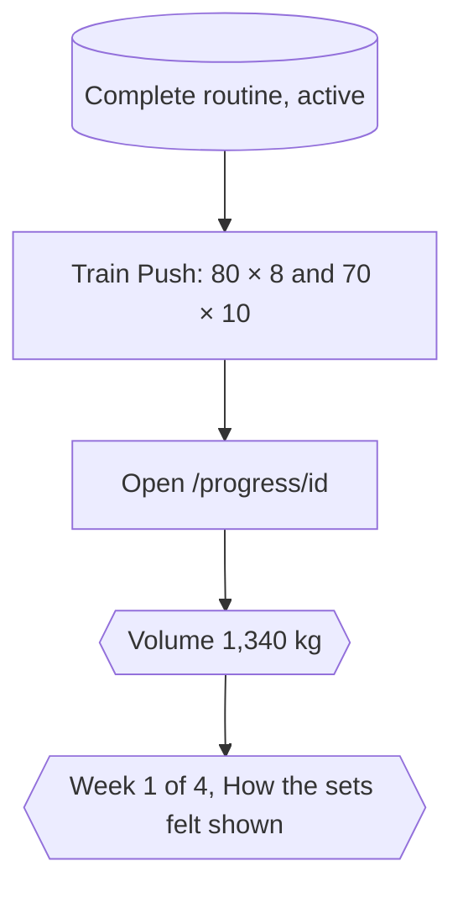

### history › exercises and days are browsed one at a time

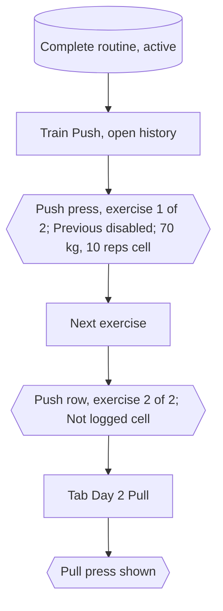

### history › the history exports as a spreadsheet

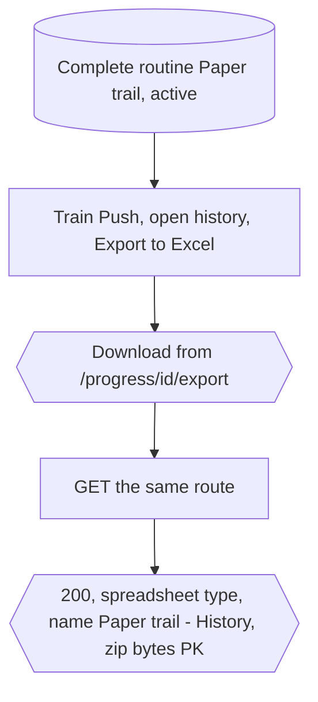

### history › members read and export it; strangers get nothing

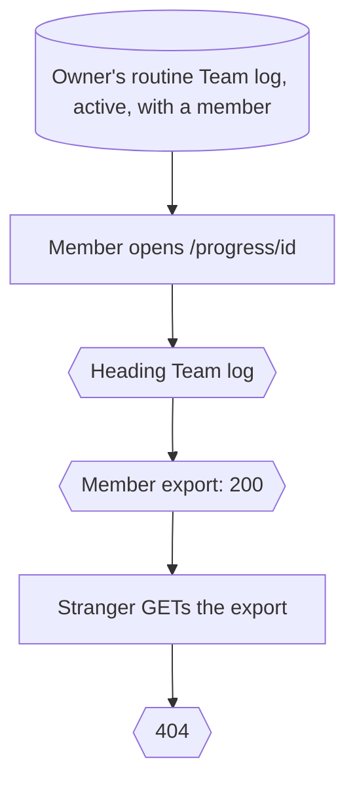

### history › a workout reads by sessions and does not export

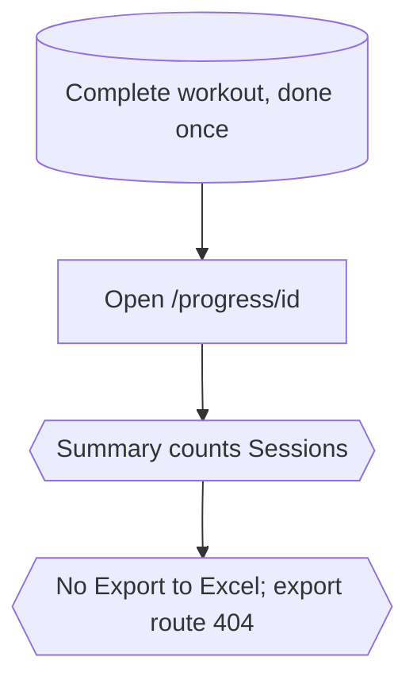
