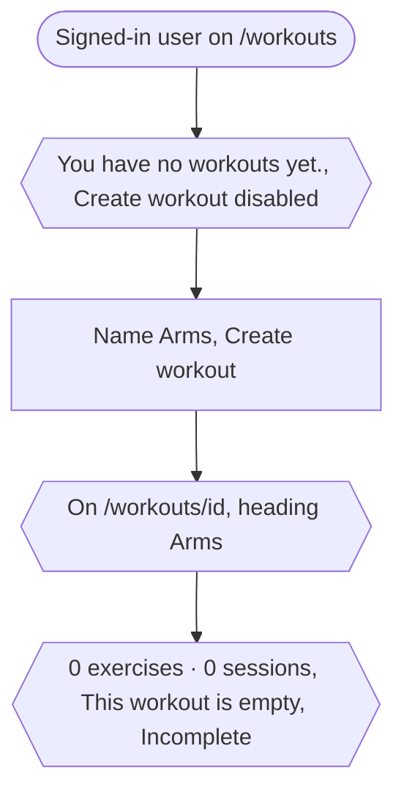
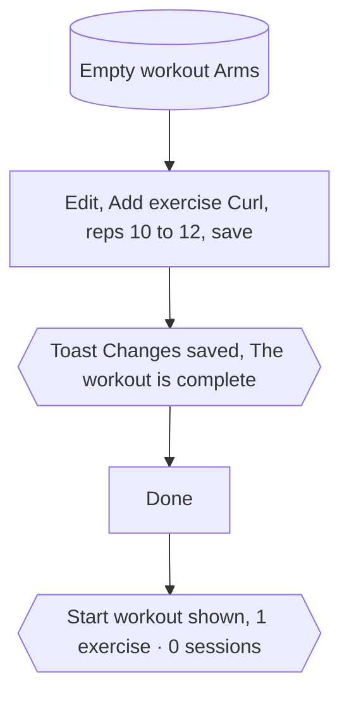
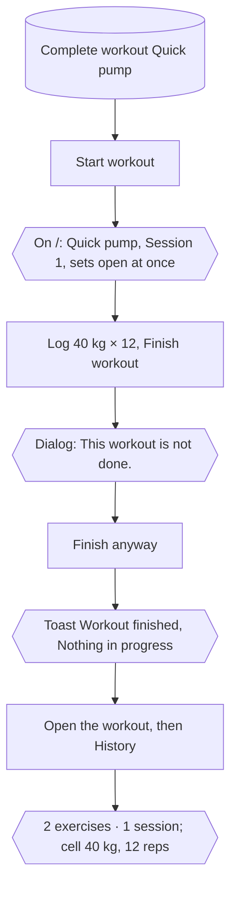
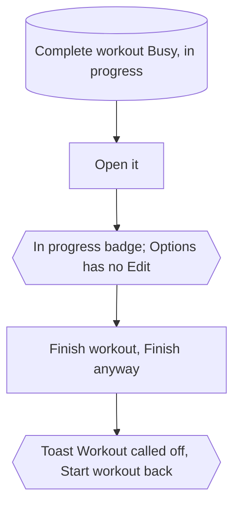
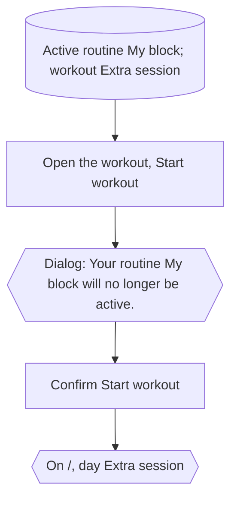
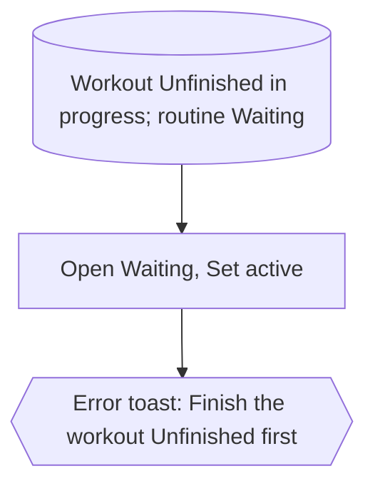
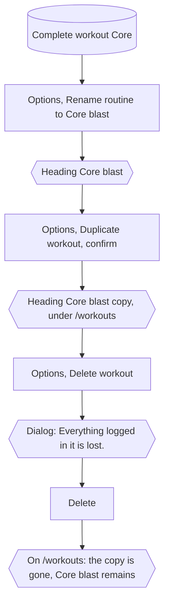
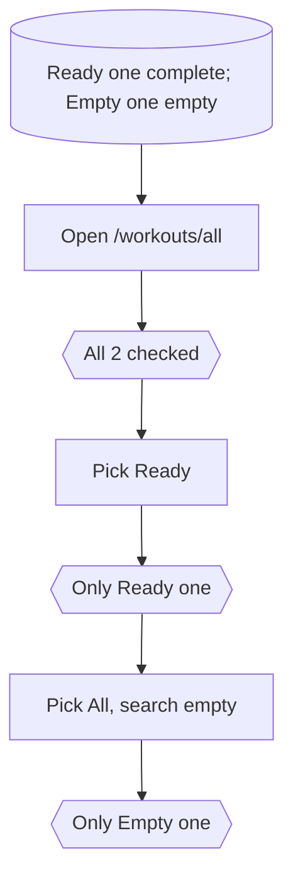

# Workout flows

[← All flows](README.md)

A seeded **complete workout** has one day under its own name, with a press (two ranged sets) and a row (one fixed set).

## `workouts/workouts.spec.ts`

### workouts › create one: named and nothing else, opening empty

### workouts › fill it in, then it is ready to start

### workouts › start, log and finish a session

### workouts › while under way it is locked for editing and can be finished from its page

### workouts › starting one over an active routine asks first

### workouts › a routine cannot be set active while a workout is under way

### workouts › rename, duplicate and delete

### workouts › the full list searches and filters by status

